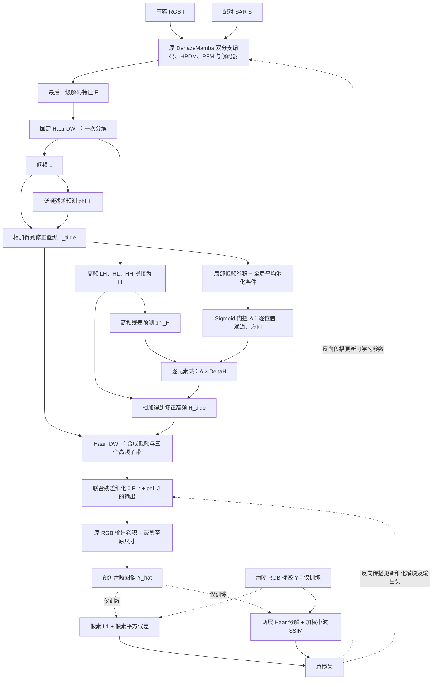

# 创新方案一：在 DehazeMamba 第 III-A 节输出重建前加入低频引导的小波细化模块，并将第 III-E 节损失改为颜色数值与小波结构联合约束

> 状态：理论设计稿，2026-11-17。已阅读 `.gitmodules` 指向的三篇本地论文及对应代码，未实现网络、未训练、未验证性能。本文的“可行”指计算图、张量接口和监督目标可成立，不表示一定优于 baseline。正文采用中文方法章节写法；文末列出来源、适配依据和后续验证边界。

## 1. 研究动机与核心假设

SAR 引导的遥感图像去雾需要同时恢复光学图像的颜色数值和空间细节。DehazeMamba 通过双分支编码、雾感知解耦模块（HPDM）及渐进融合模块（PFM）整合光学与 SAR 信息，随后由解码器和输出卷积生成清晰图像 [1]。然而，现有输出路径没有显式区分平滑变化与快速变化的特征；其像素 L1 与全局 FFT 频域 L1 约束，也没有直接提供局部、多尺度的小波结构监督。这是本方案选择的改动位置，而非已经通过实验确认的性能瓶颈。

本方案假设：融合后的末端特征仍保留可恢复的颜色与纹理信息，通过低频上下文控制高频修正，并在最终图像上同时约束 RGB 数值和多尺度结构，可能改善颜色偏差与细节恢复。具体地，将末端解码特征分解为一个低频子带和三个高频子带；分别预测低频修正与高频修正，利用低频生成的门控调节高频修正幅度，再通过逆小波变换和联合卷积完成重建。训练时引入平方误差与小波 SSIM，使数值偏差较大和结构不一致的输出获得相应惩罚。

需要区分两类“频率”。在图像域，低频通常对应缓慢变化的亮度、颜色与大尺度轮廓，高频通常对应边缘、纹理及部分噪声。在本方案的网络模块中，小波作用于学习到的特征通道，因此它们严格表示**特征的空间频率**，不能把某个低频通道直接解释成物理颜色或雾浓度。颜色恢复是否改善，必须由最终 RGB 输出的监督和评价判断。

### 1.1 统一符号

| 符号或术语 | 本文定义 |
| --- | --- |
| baseline | `.gitmodules` 第 12–16 行的 `modules/dehazeMamba`，不是其他同名论文或网络 |
| 工作副本 | `modules/dehazeMambaTry`，本次仅在其中写设计文档 |
| $I,S,Y$ | 有雾 RGB、配对 SAR、清晰 RGB 监督图像 |
| $F,\widehat Y$ | 最后一级解码特征、最终预测 RGB |
| DWT / IDWT | 离散小波变换 / 逆离散小波变换，均使用固定正交 Haar 滤波器 |
| $L,H_{LH},H_{HL},H_{HH}$ | 低频与三个方向的高频特征子带；方向命名以滤波器顺序为准 |
| $A$ | 从低频上下文生成的高频修正门控，不解释为显式雾浓度或可靠性概率 |
| W-SSIM | Y-net 的多尺度小波结构相似性监督思想；本文适配版另行定义 |

## 2. 来源机制与 baseline 的对应关系

### 2.1 baseline：保留第 III-A 至 III-D 节主体，在输出头前增加细化路径

DehazeMamba 的第 III-A 节 *Overall Framework* 和图 2 给出总体结构，第 III-E 节 *Loss Function* 的式 (8)、(9) 定义空间与频域损失 [1]。本地代码中，`DehazeMamba.forward` 完成最后一级 `decoder[0]` 后直接执行 `self.head(rgb)`，再裁剪回原尺寸；`head` 是 $C\to3$ 的 $3\times3$ 卷积。默认 $C=24$，输入先以 replicate padding 补齐至 4 的倍数。输出头没有 sigmoid、tanh，也没有直接加回有雾 RGB 的全图残差。

因此插入点确定为：

$$
\text{最后一级 decoder[0]}\longrightarrow F
\longrightarrow\boxed{\text{低频引导的小波细化}}
\longrightarrow F_{\mathrm{out}}
\longrightarrow\text{原 head}\longrightarrow\widehat Y.
\tag{P1}
$$

保持 RGB/SAR 输入、双编码器、HPDM、PFM、跳跃连接和上采样路径不变。新增模块的输入输出均为 $B\times C\times H_p\times W_p$，其中 $H_p,W_p$ 为补齐后的尺寸。它处理已融合的光学特征，不额外拼接原始 SAR，也不要求新增标签。

本地 baseline 是项目对论文的实现：代码明确将宽度、状态维度和层数分配标注为复现选择。以下方案针对这一实际实现，不将它等同于已核实的作者官方完整训练实现。

### 2.2 WaveDH：借用分频处理与可逆重建，增加显式的低频到高频修正门控

本地 WaveDH 期刊版第 3.3 节 *Frequency-aware feature refinement block*、图 3(c)、式 (14)–(16) 的核心流程为：低频经过 FMB 处理，与原高频经 IDWT 重建，再由 ESDB 联合细化 [2]。对应代码为 `WaveBottleNeck.forward`：

$$
F\xrightarrow{\mathrm{DWT}}(L,H),\quad
L'=\mathrm{FMBs}(L),\quad
F'=\mathrm{ESDB}(\mathrm{IDWT}(L',H))+F.
\tag{P2}
$$

WaveDH 的 `WaveDownampler` 也使用低频与方向高频共同构造注意力，但其作用对象是压缩后的下采样特征。本方案不照搬该下采样器，而是在分辨率不变的输出前细化模块内，令低频单独生成门控，作用于可正可负的高频残差修正。此处的门控位置和修正方式是本次适配设计，不能归为 WaveDH 原有公式。

### 2.3 Y-net：借用 L2 与小波结构监督，明确论文和仓库差异

Y-net 第 2.2 节式 (2)–(7)、算法 1，将图像逐级分解，并对各级高频和末级低频计算加权 SSIM；正文指出使用 $L_2+L_{\mathrm{W\text{-}SSIM}}$ 弥补低频数值恢复的不足 [3]。第 3.1 节使用 Haar、小波层数 3、$r=0.4$。

仓库 `WSloss.forward` 则默认 **2 层、$r=0.7$**，包含原图负 SSIM，并用拼接的 LH/HL 通道均值乘 $2m$ 表示两个方向的贡献。`WSloss` 自身不包含 L2。论文正文写明先计算原图 SSIM，但算法 1 的伪代码未显式列出该项；其权重更新记号也不如代码明确。本文据正文和代码保留原图项，并显式写出递推权重，避免照抄含糊记号。

本文固定首版为 **2 层、$r=0.4$**：两层是面向细小遥感纹理和训练成本的设计选择，$r=0.4$ 来自论文的高频侧重设置；这不是声称复现 Y-net 的完整训练配置。另对 SSIM 输入进行固定尺度变换，见第 4 节。

## 3. 改动一：将第 III-A 节的输出重建路径改为低频引导的小波细化

### 3.1 保留全部子带的 Haar 分解

对每个特征通道独立执行单层二维 Haar DWT。设相邻 $2\times2$ 特征块为 $\left[\begin{smallmatrix}a&b\\c&d\end{smallmatrix}\right]$，采用与 WaveDH 分析滤波器一致的约定：

$$
L=\frac{a+b+c+d}{2},\quad
H_{LH}=\frac{a+b-c-d}{2},\quad
H_{HL}=\frac{a-b+c-d}{2},\quad
H_{HH}=\frac{a-b-c+d}{2}.
\tag{P3}
$$

这里 LH/HL 取决于横纵轴命名，不影响机制，但未来实现必须保持分析与合成顺序一致。令 $H=\operatorname{Concat}(H_{LH},H_{HL},H_{HH})$，则

$$
L\in\mathbb R^{B\times C\times H_p/2\times W_p/2},\qquad
H\in\mathbb R^{B\times3C\times H_p/2\times W_p/2}.
\tag{P4}
$$

四个子带的系数总数等于输入元素数。这里没有丢弃高频；采用匹配的 IDWT 时，单独的 DWT/IDWT 组合可精确重建输入（浮点误差除外）。这只说明变换可逆，不说明经学习修正后的结果必然更好。

### 3.2 低频分支：修正平滑上下文并生成全局条件

以较大卷积核处理低频，预测平滑部分的残差：

$$
\Delta L=\phi_L(L),\qquad \widetilde L=L+\Delta L.
\tag{P5}
$$

首版 $\phi_L$ 定义为 $1\times1$ 卷积（$C\to C$）、SiLU、$7\times7$ 深度卷积、SiLU 和 $1\times1$ 卷积（$C\to C$），空间尺寸保持不变。该分支借鉴 WaveDH 在低频上扩大感受野的思路，不完整复制其 FMB。

较大卷积核仍然只提供有限邻域，不能直接称为全局建模。因此另从 $\widetilde L$ 提取全局平均池化条件，与局部低频上下文共同生成门控：

$$
U=\operatorname{Conv}_{1\times1}^{C\to C}
\bigl(\operatorname{GAP}(\widetilde L)\bigr),
$$

$$
A=\sigma\left[
\operatorname{Conv}_{1\times1}^{C\to3C}
\left(\operatorname{SiLU}\left(
\operatorname{DWConv}_{3\times3}(\widetilde L)
+\operatorname{Broadcast}(U)\right)\right)
\right].
\tag{P6}
$$

$A\in(0,1)^{B\times3C\times H_p/2\times W_p/2}$，每个位置、通道及方向均可获得不同的修正权重。全局池化提供画面整体条件，局部分支保留空间差异。门控的输入仅来自低频路径，不使用清晰图像或测试标签。

### 3.3 高频分支：门控控制修正幅度，而非直接放大所有纹理

高频既可能是真实边缘，也可能包含噪声或模态融合伪影。因此不把高频系数统一放大，而是学习带符号的修正量：

$$
\Delta H=\phi_H(H),\qquad
\widetilde H=H+A\odot\Delta H.
\tag{P7}
$$

首版 $\phi_H$ 使用 $3\times3$ 深度卷积（$3C$ 通道）、SiLU、$1\times1$ 卷积（$3C\to3C$）。末层不加 ReLU，允许修正为正或负；点卷积允许三个方向和各特征通道交换信息。

当 $A$ 较小时，原高频主要通过恒等路径保留；当 $A$ 较大时，网络可执行更强修正。若原系数为正，负修正可以削弱它，正修正可以增强它；负系数同理。故这里既可抑制噪声，也可补偿细节，而不是将“高频强”直接等同于“清晰”。但门控并不自动知道哪些是噪声，区分能力仍来自配对监督。Sigmoid 仅限制修正权重，不限制 $\Delta H$ 的绝对大小，也不构成稳定性证明。

### 3.4 逆变换与联合重建

将 $\widetilde H$ 按原顺序拆成三个子带，与 $\widetilde L$ 合成：

$$
F_r=\operatorname{IDWT}(\widetilde L,
\widetilde H_{LH},\widetilde H_{HL},\widetilde H_{HH}),
\qquad
F_{\mathrm{out}}=F_r+\phi_J(F_r),
\tag{P8}
$$

$$
\widehat Y=\operatorname{Crop}_{H,W}
\left(\operatorname{Conv}_{3\times3}^{C\to3}(F_{\mathrm{out}})\right).
\tag{P9}
$$

$\phi_J$ 为 $3\times3$ 深度卷积、SiLU 和 $1\times1$ 卷积（$C\to C$），在重建后共同协调低、高频信息。所有卷积均使用保持尺寸的 padding。原输出头保留，训练时不在输出或损失前硬裁剪至 $[0,1]$，避免越界预测失去纠正梯度；评价沿用 baseline 的输出裁剪口径。

为使新增模块可以从原 baseline 行为开始，拟将 $\phi_L,\phi_H,\phi_J$ 的末层权重及偏置初始化为零，其余层使用常规初始化。此时 $\Delta L=\Delta H=\phi_J(F_r)=0$，从而 $F_{\mathrm{out}}=F$。门控末层可初始化为零，使 $A=0.5$。这时高频修正末层仍可获得梯度；门控在高频修正开始非零后才获得有效学习信号。此初始化提供可退化回 baseline 的计算路径，不保证训练始终不退化。

### 3.5 算法流程图

**图 1｜低频引导的小波细化与颜色—结构监督。** 实线表示前向数据流，虚线表示训练监督或参数更新。网络内 DWT 作用于末端特征，仅分解一次；损失内 DWT 作用于预测与标签 RGB，递归分解两次。二者共享 Haar 变换约定，但不共享特征张量。反向传播经过输出头和全部新增分支，固定滤波器本身不更新。推理仅保留从输入到预测的前向路径。

算法步骤为：①按原 baseline 提取融合解码特征；②DWT 得到四个子带；③预测低频残差并生成局部与全局条件门控；④预测并门控高频残差；⑤IDWT 合成并联合细化；⑥用原输出头生成 RGB；⑦仅训练时计算第 4 节联合损失并反向传播。

## 4. 改动二：将第 III-E 节式 (8)、(9) 的目标改为颜色数值与小波结构联合损失

### 4.1 baseline 原目标与替换范围

原论文和本地 `dehaze_loss` 使用：

$$
\mathcal L_{\mathrm{base}}
=\operatorname{mean}|\widehat Y-Y|
+0.1\operatorname{mean}|\mathcal F(\widehat Y)-\mathcal F(Y)|.
\tag{P10}
$$

本地 $\mathcal F$ 是未做正交归一化的完整 `fft2`，频域绝对值是复数差的模，而不是实部、虚部分开求平均。主方案保留像素 L1，**移除 FFT 项，加入像素均方误差和适配的小波 SSIM**：

$$
\boxed{
\mathcal L_{\mathrm{new}}
=\mathcal L_1+\lambda_2\mathcal L_{\mathrm{RGB},2}
+\lambda_W\mathcal L_{\mathrm{W\text{-}SSIM}}^{\mathrm{adapt}}
}.
\tag{P11}
$$

其中首版试验起点为 $\lambda_2=1,\lambda_W=0.1$，不是已调优系数，也不表示与原 FFT 权重数值等价。FFT 的全局频谱匹配信息不与局部 W-SSIM 等价，替换可能失去部分有用约束；保留 FFT 的对照用于验证该取舍。

### 4.2 RGB 数值约束：对较大偏差给予更强的相对惩罚

设 $N=3BHW$，在原尺寸预测和标签上计算：

$$
\mathcal L_1=\frac1N\sum_i|\widehat Y_i-Y_i|,\qquad
\mathcal L_{\mathrm{RGB},2}=\frac1N\sum_i(\widehat Y_i-Y_i)^2.
\tag{P12}
$$

对单个误差 $e$，L1 的非零误差梯度大小固定，而平方项的梯度大小为 $2|e|$。在组合项 $|e|+\lambda_2e^2$ 中，大误差因此获得更大的附加梯度。例如误差从 0.1 增至 0.2，L1 增长为 2 倍，平方项增长为 4 倍。需要避免“L2 的数值总是比 L1 大”的说法：当 $|e|<1$ 时，$e^2<|e|$，这里强调的是相对增长及附加梯度。

该项直接比较三个 RGB 通道，约束亮度和颜色数值偏移；它不是专门的感知色差公式，也不能保证光谱反射率正确。本文只处理 baseline 的 8-bit RGB 归一化图像，不扩展为多光谱定量恢复。

### 4.3 多尺度小波结构约束

对 $X\in\{\widehat Y,Y\}$，令 $L_X^{(0)}=X$，仅递归分解低频：

$$
(L_X^{(j)},H_{X,LH}^{(j)},H_{X,HL}^{(j)},H_{X,HH}^{(j)})
=\operatorname{DWT}(L_X^{(j-1)}),\quad j=1,2.
\tag{P13}
$$

**固定尺度变换。** 正交 Haar 的 LL 幅值随层数变化，高频还包含负值；直接沿用 RGB 的 SSIM 常数会使各层尺度不一致。对第 $j$ 层，本文定义

$$
\overline L_X^{(j)}=2^{-j}L_X^{(j)},\qquad
\overline H_{X,k}^{(j)}=2^{-j}H_{X,k}^{(j)}+\tfrac12.
\tag{P14}
$$

对于 $[0,1]$ RGB 标签，这使 LL 及平移后的高频位于 $[0,1]$ 范围。预测采用同一固定变换，不逐图 min-max 归一化，不取高频绝对值，不裁掉越界值，因此保留幅值和符号差异。平移和缩放会改变相对原始 Y-net 的 SSIM 行为，属于显式适配，而不是其原式。

定义 $\ell_s(U,V)=1-\operatorname{SSIM}(U,V)$。SSIM 按 RGB 通道分别计算后取均值，使用 $11\times11$ 高斯窗、标准差 1.5、$C_1=0.01^2,C_2=0.03^2$，并对有效窗口中心平均，避免把零 padding 计为真实结构。均值、方差和协方差均由同一归一化窗口计算。方差仅对浮点产生的微小负值截为零，SSIM 计算使用 float32。首版要求原图至少 $44\times44$，使两层后仍可使用有效的 11 像素窗口；512 像素输入满足条件。

固定 $r=0.4,J=2$，以 Y-net 的频带比例定义：

$$
a_{j,LH}=a_{j,HL}=r^{2(j-1)}r(1-r),\quad
 a_{j,HH}=r^{2(j-1)}(1-r)^2,\quad a_L=r^{2J}.
\tag{P15}
$$

有 $\sum_{j,k}a_{j,k}+a_L=1$。主方案的结构项为

$$
\mathcal L_{\mathrm{W\text{-}SSIM}}^{\mathrm{adapt}}
=\frac12\left[
\ell_s(\widehat Y,Y)
+\sum_{j=1}^{J}\sum_{k\in\{LH,HL,HH\}}
 a_{j,k}\ell_s(\overline H_{\widehat Y,k}^{(j)},\overline H_{Y,k}^{(j)})
+a_L\ell_s(\overline L_{\widehat Y}^{(J)},\overline L_Y^{(J)})
\right].
\tag{P16}
$$

除以 2 使“原图项与所有频带项”的权重和为 1。采用 $1-\mathrm{SSIM}$ 代替负 SSIM，在输入及权重相同的前提下只改变常数；本文的固定尺度变换则另行改变了目标，不能把两者混为一谈。

对于上述参数，第一级 LH/HL/HH 权重为 0.24、0.24、0.36，第二级为 0.0384、0.0384、0.0576，末级 LL 为 0.0256；这些是式 (P16) 外部 $1/2$ 之前的权重。频带项因此偏重细尺度结构，像素 L1 与平方项承担直接的颜色数值约束。小波 SSIM 处罚局部均值、对比度和相关结构的不一致，并不奖励“更强的纹理能量”：虚假边缘与标签不同也会受到惩罚。它仍可能对某些结构失真不够敏感，尤其在弱纹理和噪声条件下，不能代替真实图像核验。

若输出尺寸不是 4 的倍数，仅对损失的小波支路将预测和标签同步 replicate padding；像素项和原图 SSIM 均在未补齐图像上计算。各小波尺度的 SSIM 窗口只纳入其支持完全处于原始有效区域的中心，避免补齐边界影响监督。模块内部则沿用 baseline 已有的 4 倍数 padding，最终仍裁剪回 $H,W$。

### 4.4 训练目标与网络机制的配合

低频分支提供高频修正的条件，结构损失提供高频是否接近清晰目标的监督。两者职责不同：门控并不被当作损失权重，也不允许网络通过把门控置零来直接降低监督权重。即使某处高频修正被抑制，最终 RGB 仍须满足完整的像素和结构损失。平方项则限制为了增强纹理而产生的较大通道数值偏差。

DWT、IDWT、卷积、Sigmoid 和带正稳定常数的 SSIM 均允许梯度传播，L1 在零点采用通常的次梯度。因此该目标与 baseline 的端到端优化接口相容。但非凸网络的收敛速度、最终最优点和去噪表现均需要实验判断。

## 5. 理论可行性、迁移前提与可证伪边界

| 判断对象 | 当前依据 | 结论与可能失效 | 最小后续检验 |
| --- | --- | --- | --- |
| 张量接口 | 两个 baseline 副本的模型与损失文件一致，末端输入输出均为 $B,C,H_p,W_p$ | 接口可成立；子带顺序或 padding 错误会破坏重建 | 检查随机与常量张量的 IDWT(DWT(F))、奇偶尺寸和梯度 |
| 可回到原行为 | 式 (P5)、(P7)、(P8) 的零残差设计 | 数学上成立；不是效果下界保证 | 关闭修正时与原模型输出比较 |
| 低频能指导细节 | 来自分频处理机制的设计假设，未测门控与恢复误差关系 | 有条件；低频可能把明亮地物与雾混淆 | 与恒定门控、无全局池化门控比较，分亮地物与雾强度查看误差 |
| 清晰标签支持结构监督 | loader 提供同名 RGB/SAR/GT；适配器将目标整理到同一尺寸 | 仅证实接口；文件名和尺寸不证明真实配准 | 训练/验证集人工抽查三种雾强度及边缘位移，先核验来源 |
| 高频有可恢复内容 | WaveDH 和 Y-net 提供方法依据，本任务未测频带分布 | 未知；高频可能以 SAR 噪声、重采样伪影为主 | 比较噪声切片、配准扰动下的高频误差及伪边缘 |
| 平方项有助颜色数值恢复 | 对较大误差有更大附加梯度 | 理论成立；异常标签也会获得更大梯度 | 核查异常配对，并比较 RGB MAE、RMSE、低通误差 |
| 性能与创新性 | 尚无本方案训练结果；相关频率分解研究已存在 | 只能称候选适配创新 | 用对照与消融证明收益，补充系统性近邻检索 |

**目标数据证据边界。** 本次只审阅了数据加载与 SateHaze1k 适配脚本，未抽查原始图像，样本审计数为 0；未验证跨划分同场景、近重复、配准或 SAR 生成来源。项目 README 记载 958/105/135 的 train/valid/test 数量，但它是既有记录，本次未重新计数。脚本按排序匹配 SAR 与光学输入，并将 RGB/SAR 用不同插值方法统一到 512×512；这些处理可能改变高频统计，必须先验证配对、噪声与分辨率条件。现有测试结果不作为本方案设计或调参依据。

**计算与部署边界。** 单层 Haar 变换计算量随像素数线性增长；分频后系数总量未减少，额外分支和激活仍会增加显存与推理开销。点卷积通常带来与 $C^2H_pW_p$ 成比例的计算，不能仅凭低频分辨率减半就声称整个网络更轻。损失中的两层 DWT 只用于训练。SAR 的配准和可用性要求仍与 baseline 相同。

## 6. 后续实验只验证这一条创新，不提前形成结果结论

| 变体 | 网络与损失 | 要回答的问题 |
| --- | --- | --- |
| B0 | 原 baseline + 原 L1/FFT 损失 | 原始对照 |
| B1 直接迁移 | 输出前放一个原 WaveBottleNeck，原 head；原样 WSloss 默认 2 层、r=0.7，加单独 MSE | 最小接口迁移是否已有收益；需记录其额外参数与算力 |
| B2 完整方案 | 第 3 节细化模块 + 式 (P11) | 本文适配组合是否有效 |
| A1 | 仅第 3 节模块 + 原损失 | 结构改动的独立作用 |
| A2 | 原网络 + 式 (P11) | 损失改动的独立作用 |
| A3 | B2 中固定 A=0.5，其余保持一致 | 收益是否来自低频自适应门控 |
| A4 | B2 去掉全局池化条件 | 整体画面条件是否有额外作用 |
| A5 | B2 去掉平方项 / 去掉 W-SSIM，分别比较 | 颜色数值与结构监督的分工 |
| A6 | B2 加回原 0.1 FFT 项 | 替换 FFT 是否损失有效约束 |
| A7 | B2 的小波结构项改用未做式 (P14) 变换的系数 | 固定尺度变换是否必要 |
| A8 | 用接近参数量、实测算力的普通残差卷积替换分频模块 | 收益是否仅来自增加容量 |

B1 中 WaveBottleNeck 的通道须设为 baseline 的 C，且当前默认 C=24 对其 FMB/ESDB 的分组约束是否满足，仍需后续接口检查；若不能满足，应标注直接迁移不可用或记录最小通道转换，不静默改成另一套网络。原 `dwt.py` 硬编码 CUDA 且创建带梯度的滤波器变量，后续可做设备适配、固定滤波器等机械修正，但必须保持原子带顺序与目标定义；本次未运行。

所有变体使用相同的场景级数据划分、预处理、训练轮数、批量、学习率规则与初始化来源。建议至少三个配对随机种子（2026、2027、2028），参数选择仅使用训练/验证集，并在最终测试前锁定。当前 loader 只接受 train/test，后续必须显式接入 valid 评估，不能把 test 当验证集。WaveDH、Y-net 的预训练权重不作为默认迁移输入；如果后续使用，应另外审核数据重叠。

验证指标包括 PSNR、SSIM、RGB MAE/RMSE、固定低通后的 RGB 误差，以及带符号的小波高频 MAE。按独立场景汇总重复运行的不确定性，并报告三种雾强度、平滑区域、亮地物和高噪声切片；细节判断同时检查伪边缘，不能只看锐度。结构训练目标与 SSIM 评价相关，因此需同时考察数值指标和视觉误差。

首要判据为：验证集上完整方案相较 B0 同时降低 RGB RMSE 和高频 MAE，且 PSNR/SSIM 未出现跨种子一致恶化；门控相较 A3 还须提供可重复收益，才支持“低频引导”这一具体解释。若只改善其中一项，应报告颜色—纹理权衡；若门控没有收益，应否定其必要性，而非把增加参数的收益归因于门控。这里未设武断的提升幅度，最终实际意义阈值应在训练前结合 baseline 波动与应用要求登记。本次不安排或启动训练。

## 7. 候选贡献、已有工作与声明边界

可用于未来论文的方法贡献表述为：

> 在 SAR 引导的去雾网络输出端，我们设计了一种低频条件化的高频残差修正路径。该路径保留原始小波系数的恒等传递，并通过局部低频上下文和全局条件调节细节修正。结合 RGB 数值与多尺度小波结构监督，该设计旨在协调颜色重建和纹理恢复；其效果与必要性将通过对照、消融和噪声敏感性实验检验。

其中，“小波分解”“低频处理后逆变换”“L2 + W-SSIM”分别已有 WaveDH、Y-net 等依据，不能单独作为新颖性声明。潜在贡献集中在 **SAR 融合后输出端的低频条件门控、保留高频恒等路径的带符号修正，以及适配监督的组合及验证**。这目前是工程与方法适配，尚不能保证达到独立方法创新或发表要求。

截至本次检索，已有 *Physics-Inspired Frequency-Decoupled Network for Remote Sensing Image Dehazing* 提出频率分解、选择门控和亮度感知融合 [4]。其机制与本文有邻近之处；本方案未引入其物理透射估计或对 Mamba 状态参数的调制。这里仅进行了针对性的近邻核查，没有完成全面查新，不使用“首次”“独有”或“已显著改善”等措辞。

## 8. 论文、代码及版本锚点

### 8.1 已读论文

1. **DehazeMamba**，Zhao 等，*IEEE JSTARS*，19 (2026)，DOI [10.1109/JSTARS.2025.3634360](https://doi.org/10.1109/JSTARS.2025.3634360)。本地文件：[Zhao_2026_JSTARS_DehazeMamba.pdf](/Users/johnny/Desktop/me/paperhybrid/reference/paper/conference/20261015/dehazeMamb/Zhao_2026_JSTARS_DehazeMamba.pdf)。依据第 III-A 节（PDF 第 4 页）、图 2，第 III-E 节及式 (8)、(9)（PDF 第 6–7 页）。本地期刊版为主依据，在线预印本元数据仅作交叉识别。
2. **WaveDH: wavelet sub-bands guided ConvNet for efficient image dehazing**，Hwang 等，DOI [10.1007/s00138-026-01943-5](https://doi.org/10.1007/s00138-026-01943-5)。本地文件：[WaveDH.pdf](/Users/johnny/Desktop/me/paperhybrid/reference/paper/Springer/MVA/WaveDH/WaveDH.pdf)。该 PDF 首页标为 *Machine Vision and Applications* (2027) 38:10，版权及接收年份为 2026；不同于仓库 README 引用的 [2024 预印本](https://arxiv.org/abs/2404.01604)。本文节号、式号均按本地期刊版：第 3.2 节（PDF 第 6–8 页）和第 3.3 节、式 (14)–(16)（PDF 第 8–9 页）。
3. **Y-net: Multi-scale feature aggregation network with wavelet structure similarity loss function for single image dehazing**，Yang、Yang 与 Tsai，ICASSP 2020；[arXiv:2003.13912](https://arxiv.org/abs/2003.13912)。本地文件：[Y-Net_2003.13912v1.pdf](/Users/johnny/Desktop/me/paperhybrid/reference/paper/conference/2020/ICASSP/Y-net-2003.13912/Y-Net_2003.13912v1.pdf)。依据第 2.2 节、式 (2)–(7)、算法 1 和第 3.1 节（PDF 第 2–3 页）。
4. **Physics-Inspired Frequency-Decoupled Network for Remote Sensing Image Dehazing**，Yang、Chen 与 Xu，*Sensors* 26(10), 3124 (2026)，[期刊原文](https://www.mdpi.com/1424-8220/26/10/3124)。仅用于邻近机制和新颖性边界核查，不是本方案的实现来源。

### 8.2 已读代码与精确改动接口

| 仓库与读取时 HEAD | 证据位置 | 本方案后续拟改动 |
| --- | --- | --- |
| `modules/dehazeMamba`，`3bf1f2f847cf7cb439fb6d4ae65ee4b495990dd2` | [model.py:232](/Users/johnny/Desktop/me/paperhybrid/modules/dehazeMamba/dehazemamba/model.py:232)，特别是 `forward` 的 decoder 循环及第 291 行输出；[losses.py:10](/Users/johnny/Desktop/me/paperhybrid/modules/dehazeMamba/dehazemamba/losses.py:10) | 作为原 baseline 留存 |
| `modules/dehazeMambaTry`，同一 HEAD | [model.py:267](/Users/johnny/Desktop/me/paperhybrid/modules/dehazeMambaTry/dehazemamba/model.py:267)、[losses.py:10](/Users/johnny/Desktop/me/paperhybrid/modules/dehazeMambaTry/dehazemamba/losses.py:10)、[train_dehaze.py:108](/Users/johnny/Desktop/me/paperhybrid/modules/dehazeMambaTry/train_dehaze.py:108) | 将来在 `head` 前插入同尺寸模块，训练入口替换损失并分别记录 L1、MSE、W-SSIM；不得继续把新日志分量标为 FFT |
| `modules/WaveDH`，`7fb3918790adb6cd0a3b7c680f1b95936d23f028` | [WaveDH.py:94](/Users/johnny/Desktop/me/paperhybrid/modules/WaveDH/models/WaveDH.py:94)，`WaveBottleNeck`；同文件 `WaveDownampler`、`WaveUpsampler`；[torch_wavelets.py](/Users/johnny/Desktop/me/paperhybrid/modules/WaveDH/models/torch_wavelets.py) | 借用固定 Haar 分解/合成与分频细化机制，新增条件门控 |
| `modules/Y-net`，`544c1a70db5716a6269fd57623c7c68a0a21b193` | [wavelet_ssim_loss.py:12](/Users/johnny/Desktop/me/paperhybrid/modules/Y-net/wavelet_ssim_loss.py:12)、[dwt.py](/Users/johnny/Desktop/me/paperhybrid/modules/Y-net/dwt.py)、[pytorch_ssim/__init__.py](/Users/johnny/Desktop/me/paperhybrid/modules/Y-net/pytorch_ssim/__init__.py) | 借用多尺度监督；显式修订层数/权重约定、尺度处理及设备管理 |

两个 baseline 副本的 `model.py` 与 `losses.py` 经文本比较一致。数据接口依据 `dehazemamba/data.py`；SateHaze1k 配对与重采样依据 `myexperiment/script/prepare_satehaze.py`；评价端输出裁剪依据 `evaluate_dehaze.py`。本次没有加载外部检查点，没有执行上游训练、数据准备或模型测试脚本。WaveDH README 当前列出的训练代码仍未提供，故没有声称完成源模型训练流程复现。

WaveDH 代码采用 MIT，Y-net 代码采用 Apache-2.0；如后续直接复用代码，应保留对应许可和版权信息。当前交付为有来源标注的方法设计，不复制实现。

### 8.3 主张—证据核对

| 主张 | 证据 | 状态 |
| --- | --- | --- |
| 插入位置和张量接口明确 | 实际 `forward`、padding、head 定义 | 代码支持 |
| 小波分解可逆、残差为零时退化至原特征 | 固定正交 Haar 与式 (P3)–(P9) | 理论支持，待实现检查 |
| 颜色大误差获得额外梯度 | 式 (P12) 的导数 | 数学支持 |
| 低频门控能区分真实纹理与噪声 | 目前仅有任务假设 | 待实验 |
| 方案提升 PSNR、颜色与纹理质量 | 尚无本方案结果 | 不作结论 |
| 方案具有足够学术新颖性 | 有直接来源与邻近工作，未全面查新 | 未确定 |

文档按“问题与来源 → 网络改动 → 损失改动 → 可行性与检验”组织，使读者可以先定位对原论文的修改，再复核完整计算流程。下一步是核验配准与划分，并按本文件实施及消融；这些工作不属于本次已完成内容。
