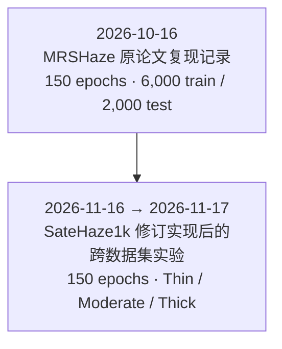

# DehazeMamba 实验时间线

> **● 2026-10-16 — MRSHaze 原论文复现记录**
>
> - 数据集：MRSHaze，训练集 6,000 对，测试集 2,000 对。
> - 实验：150 轮训练与完整测试集评估；测试集平均 PSNR 为 30.9914 dB，SSIM 为 0.930447。
> - 记录：[reproduce_2026-10-16.md](reports/reproduce_2026-10-16.md)
> - 对应代码版本：[52257ae](https://github.com/algorvel/mamba/commit/52257ae2a2965fa53242bac0b58358c4878ed18d)，提交说明为 `Add DehazeMamba reproduction`（2026-09-29）。
> - 日期说明：2026-10-16 是报告记录日期；报告记载训练于 2026-09-29 启动，约于 2026-10-03 完成。
>
> │
> ▼
>
> **● 2026-11-16 — 修订实现并开展 SateHaze1k 实验**
>
> - 数据集：SateHaze1k thin、moderate、thick 三个雾强度子集；958 对训练、105 对验证、135 对测试。moderate 训练集有 2 对损坏目标图，实验中跳过。
> - 实验：使用修订版 DehazeMamba 训练 150 轮，并完成 135 张测试图像评估；总体 PSNR 为 24.3468 dB、SSIM 为 0.8974、LPIPS 为 0.0910。
> - 记录：[experiment_report.md](reports/experiment_report.md)
> - 对应代码与实验记录提交：[ce1e551](https://github.com/algorvel/mamba/commit/ce1e5518745ba37ea4c01b3ba853c5cb3d1a86e4)，提交说明为 `Fix DehazeMamba paper reproduction and add SateHaze experiment`（2026-11-17）。训练于 2026-11-16 启动，报告于 2026-11-17 记载完成。
> - 说明：这是 SateHaze1k 上的跨数据集实验，不等同于论文在 MRSHaze/SEN12MS-CR 上报告的结果。
